**App Developer at Sinwaz · Building Internal Operational Systems**

I'm Fathan Aprian, a web developer based in Indonesia. I currently develop applications at Sinwaz, building internal operational systems — including a live-host operations system and a camera & receipt-scanning packing documentation system. My main stack is Laravel on the backend and React + Vite on the frontend, and I'm also building a sneaker e-commerce project with a Laravel API and a separate React frontend.

I focus on web apps that solve real operational problems: clear flows, reliable data, and interfaces that are easy for the team using them every day.

  
  
  
  
  

## Core Tech Stacks

  

## Other Tech Stacks

  

## Tools

  

## Statistics

  
  

  

## Featured Projects

- **SpaceGo — Booking Lapangan / Fasilitas Sekolah** · Laravel 11, PHP, MySQL, Tailwind CSS
  Sistem booking fasilitas sekolah terpadu (lapangan, lab, ruang multimedia) dengan pengecekan jadwal anti double-booking.
  → https://github.com/rianinajaa/booking-lapangan

- **Kicks Store (frontend) + Kicks API (backend)** · React, Vite, Laravel
  Frontend toko sneaker dengan React + Vite, terhubung ke API Laravel terpisah.
  → https://github.com/rianinajaa/kicks-store · https://github.com/rianinajaa/kicks-api
  *(saat ini masih private)*

- **SINWAZ Proof** · TypeScript
  Sistem pendataan & dokumentasi pengemasan otomatis lewat kamera dan pemindaian resi untuk PT Kreasinya Lewati Zaman (SINWAZ).
  → https://github.com/rianinajaa/sinwaz-proof
  *(repo internal, private)*

## Koleksi Landing Page

Kumpulan landing page single-file (HTML/CSS/JS) dengan animasi dan elemen 3D interaktif:

- **Ascend** · HTML, CSS, JavaScript, Three.js
  Landing page SaaS "revenue command center" tema gelap dengan planet WebGL interaktif dan scroll-reveal.
  → [Repo](https://github.com/rianinajaa/ascend-landingpage) · [Demo live](https://rianinajaa.github.io/ascend-landingpage/)

- **Gravity** · HTML, CSS, JavaScript, Three.js
  Landing page digital studio tema terang dengan orb 3D interaktif, loader animasi, dan background yang berubah tiap stage saat scroll.
  → [Repo](https://github.com/rianinajaa/gravity-landingpage) · [Demo live](https://rianinajaa.github.io/gravity-landingpage/)

- **Kimi Antonelli — GRIDO1** · HTML, CSS, JavaScript, Three.js
  Halaman tribute pembalap F1 Mercedes dengan hero animasi, efek parallax, dan canvas/WebGL.
  → [Repo](https://github.com/rianinajaa/antonelli-landingpage) · [Demo live](https://rianinajaa.github.io/antonelli-landingpage/)

- **Marcus Vane** · HTML, CSS, JavaScript
  Landing page personal brand founder · investor · operator, tema gelap premium dengan animasi reveal dan smooth scroll.
  → [Repo](https://github.com/rianinajaa/marcus-landingpage) · [Demo live](https://rianinajaa.github.io/marcus-landingpage/)

- **SodaPure** · HTML, CSS, JavaScript, GSAP
  Landing page produk diet soda zero sugar dengan model 3D interaktif, animasi gelembung, dan background gradien dinamis.
  → [Repo](https://github.com/rianinajaa/SodaPure-landingpage) · [Demo live](https://rianinajaa.github.io/SodaPure-landingpage/)

## Contribution Snake

  <picture>
    <source media="(prefers-color-scheme: dark)" srcset="https://raw.githubusercontent.com/rianinajaa/rianinajaa/output/github-contribution-grid-snake-dark.svg" />
    <source media="(prefers-color-scheme: light)" srcset="https://raw.githubusercontent.com/rianinajaa/rianinajaa/output/github-contribution-grid-snake.svg" />
    
  </picture>

